<div align="center">


# Campus Arena: PESU Sports Slot Booking System

**An online sports slot booking portal for PES University, RR Campus**  
Students see what is available and join shared slots. The sports department gets a full admin console with rosters, history and automatic bans.

**Live demo:** [slot-booking-system.vercel.app](https://slot-booking-system.vercel.app)

[](https://fastapi.tiangolo.com/)
[](https://react.dev/)
[](https://www.mongodb.com/atlas)
[](https://vitejs.dev/)
[](https://www.python.org/)

</div>

---

## Why this exists

Booking a court used to mean walking to the ground and writing your name in a register. That is slow for the sports department, unfair to day scholars who live far from campus, and leaves no record of who actually used a court. Campus Arena moves all of it online:

- **Fair for everyone.** Day scholars and hostellers see the same slots at the same time.
- **Clear availability.** Staff, cleaning and lunch hours are never shown as bookable.
- **Accountable.** For every slot, admins can see who joined, who was the leader and who cancelled.

---

## Screenshots

### Student view

**Sign in with PESU credentials**
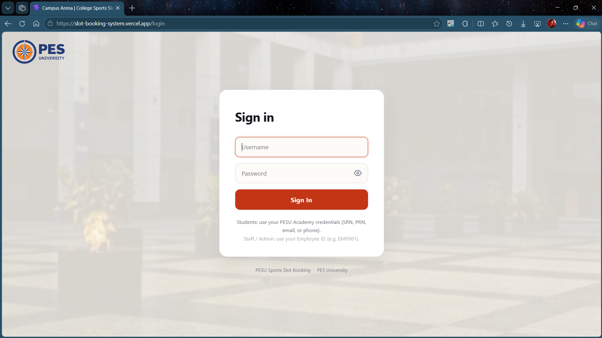

**Home: pick a day and a sport**
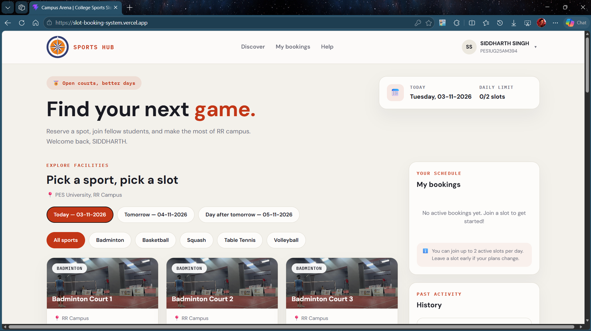

**Join a shared slot (1/6 joined, Leader tag, Leave slot)**
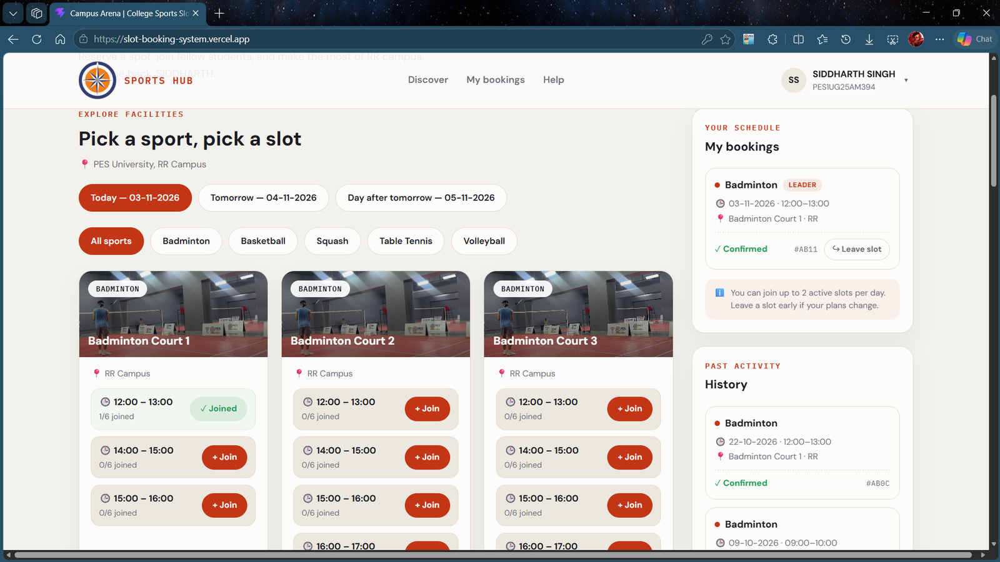

### Admin console

**Dashboard: live metrics and Create Slot**
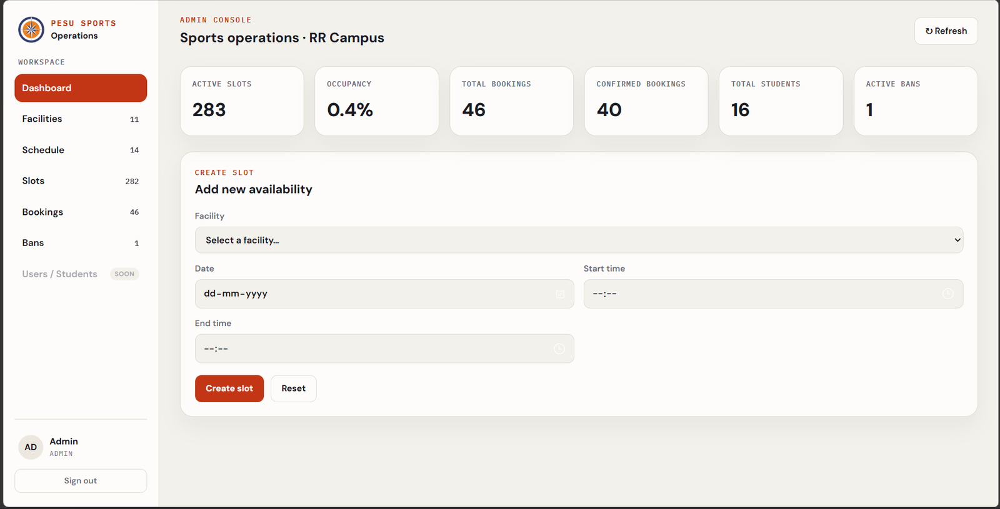

**Facilities: all 11 RR facilities with capacity**
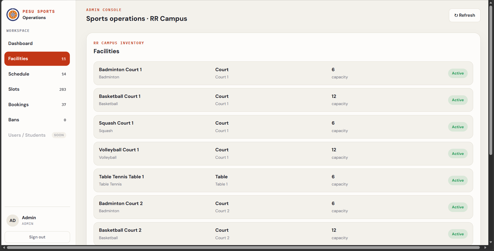

**Schedule: staff, cleaning, lunch and student periods**
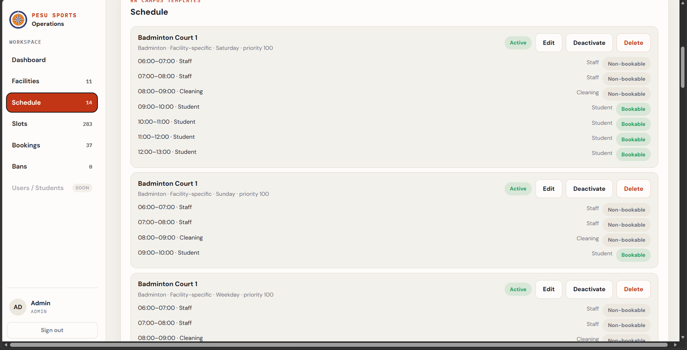

**Create or edit a schedule template**
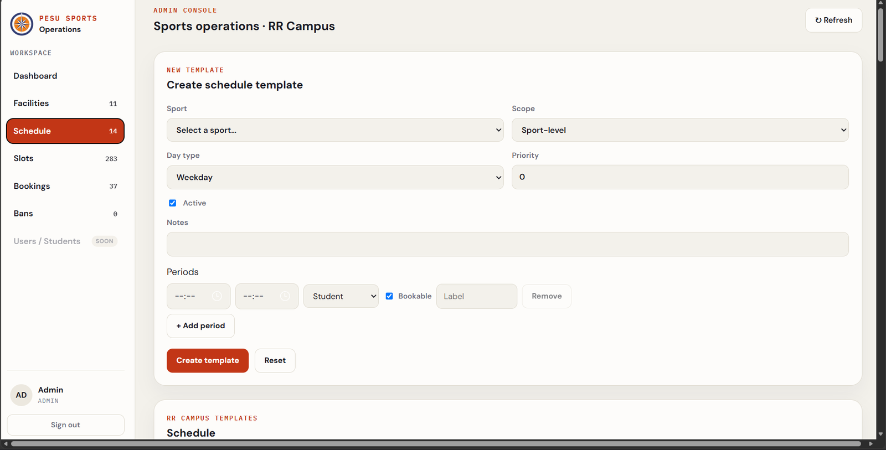

**Slots: occupancy per slot, with Roster, Edit, Cancel and Delete**
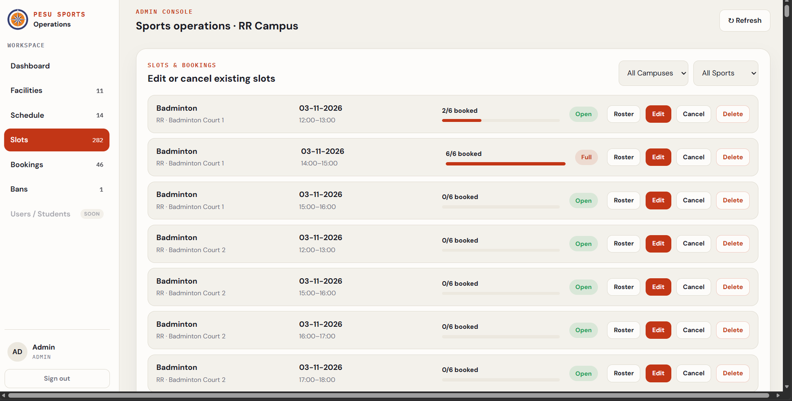

**Roster: who joined a slot, for accountability**
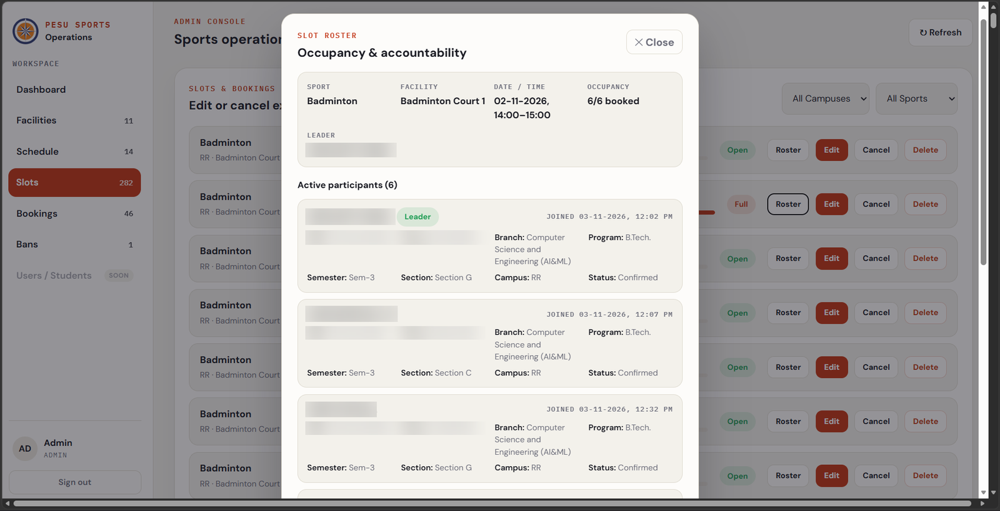

**Complete booking history**
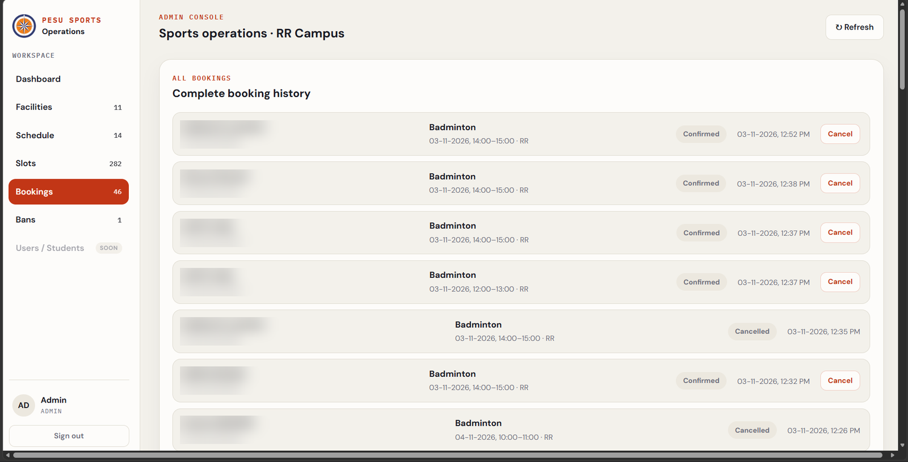

**Active bans, with Lift ban**
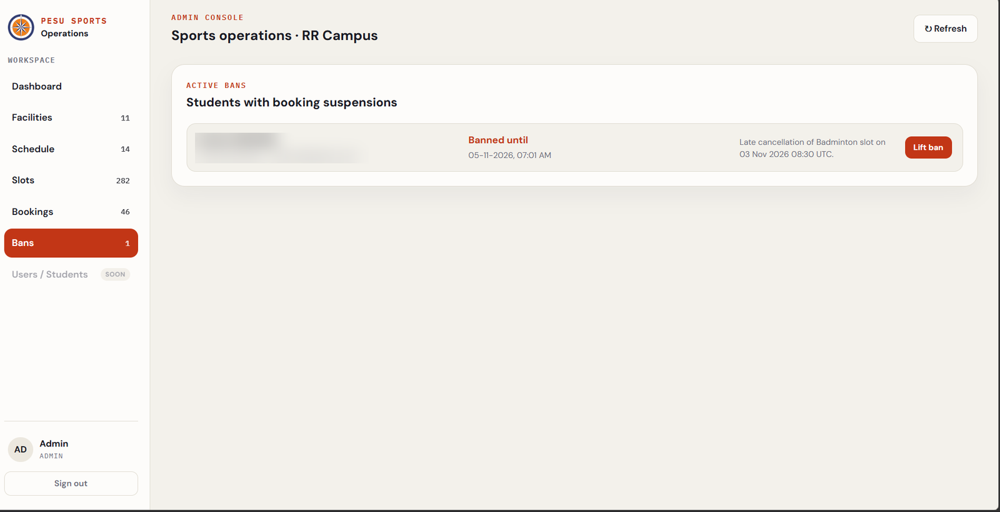

---

## Features

### Student portal
- **PESUAuth login.** Sign in with SRN, PRN, email or phone number through the PESU authentication service.
- **Facility-aware slots.** Browse Badminton, Table Tennis, Squash, Basketball and Volleyball for today and the next two days, with live "joined" counts.
- **Join a shared slot.** A court or table is shared by several students (see capacities below). Joining is confirmed instantly.
- **Leader tag.** The first student to join a slot is its leader and is the accountable person.
- **My bookings and history.** See your active slots, leave a slot, and review past activity.
- **Daily limit counter.** See how many of your 2 daily slots you have used.
- **Ban banner.** A clear notice with the expiry time if booking is paused.

### Admin console
| Page | What it does |
|------|--------------|
| **Dashboard** | Live metrics (active slots, occupancy, total and confirmed bookings, students, active bans) and a form to create a one-off slot for any facility, date and time |
| **Facilities** | The 11 RR facilities with sport, type, capacity and status |
| **Schedule** | Schedule templates by sport or facility and by day type (weekday, Saturday, Sunday). Create, edit, deactivate or delete |
| **Slots** | Every slot with its occupancy bar and Open or Full status. Open the **Roster**, edit, cancel or delete a slot |
| **Bookings** | Complete booking history with force-cancel |
| **Bans** | Students currently paused, the reason, and a Lift ban button |

### Facilities and capacity (RR campus)
| Sport | Facilities | Capacity each |
|-------|-----------|:-------------:|
| Badminton | Courts 1 to 3 | 6 |
| Table Tennis | Tables 1 to 3 | 6 |
| Squash | Courts 1 and 2 | 6 |
| Basketball | Courts 1 and 2 | 12 |
| Volleyball | Court 1 | 12 |

### Booking rules (enforced on the backend)
- **Shared slots.** Many students can join the same slot, up to its capacity. Capacity is checked and updated atomically, so two students tapping Join at the same moment can never overbook a slot.
- **2 active slots per student per day,** across all sports and facilities.
- **No overlapping slots** for the same student.
- **Leader.** The first active participant is the leader. If the leader leaves, the earliest remaining participant takes over.
- **No rejoining.** Once you leave a slot you cannot rejoin that same slot.
- **2-hour cancellation window.** Leaving less than 2 hours before the start triggers an automatic **2-day booking ban**. Both values are configurable.
- **History is kept.** Cancelling never deletes a booking. It records who joined, when, who cancelled and a snapshot of their details.

### Privacy
Students only ever see how many people have joined a slot, never who. Names, SRNs and phone numbers are returned only to admin accounts.

### Schedule templates and slot generation
Schedules live in MongoDB as **templates**, not in code. A template says which hours of a day are staff, cleaning, lunch or student time. Facility-specific templates override sport-level ones, and only student hours become bookable 1-hour slots. Slots for a date are generated automatically the first time that date is viewed. Re-running generation never resets existing bookings, and manually created slots are never overwritten.

### Real-time updates (WebSocket)
Open dashboards refresh instantly when anyone joins, leaves or when a slot changes. The frontend reconnects automatically if the connection drops.

### Security and auth
- JWT access tokens plus opaque refresh tokens (stored hashed in the database).
- Tokens are kept in `sessionStorage` and cleared when the tab closes.
- Rate limiting on the login endpoint (`slowapi`).
- Admin routes are protected by an admin-only guard.

### Email notifications (optional)
Booking and cancellation emails, silently skipped if SMTP is not configured.

---

## Tech stack

| Layer | Technology |
|-------|-----------|
| Backend framework | FastAPI 0.115 + Uvicorn |
| Database | MongoDB Atlas (Motor async driver) |
| Auth | PESUAuth for students, employee-ID login for admins, JWT (`python-jose`) |
| HTTP client | httpx (PESUAuth integration) |
| Rate limiting | slowapi |
| Email | aiosmtplib |
| Real-time | WebSockets (native FastAPI) |
| Validation | Pydantic v2 |
| Frontend | React 19 + Vite 8 |
| Routing and HTTP | React Router 7, Axios |
| Hosting | Vercel (frontend), Render (backend), MongoDB Atlas (database) |

---

## Project structure

```
Slot-booking-system/
├── backend/
│   ├── app/
│   │   ├── main.py                    # FastAPI app, CORS, /health, WebSockets
│   │   ├── config.py                  # Settings loaded from .env
│   │   ├── database.py                # MongoDB connection
│   │   ├── dependencies.py            # JWT guards (current user, admin only)
│   │   ├── ws_manager.py              # WebSocket connection manager
│   │   ├── routers/                   # auth.py, bookings.py, admin.py
│   │   ├── services/
│   │   │   ├── auth_service.py        # PESUAuth, admin login, tokens
│   │   │   ├── booking_service.py     # Join, leave, limits, bans
│   │   │   ├── admin_service.py       # Slots, roster, metrics, templates
│   │   │   ├── slot_generation_service.py  # Slots from schedule templates
│   │   │   └── email_service.py
│   │   ├── schemas/                   # Request and response models
│   │   └── models/                    # users, facilities, slots, bookings,
│   │                                  # schedule_templates, sessions
│   ├── tests/                         # Unit tests for booking, admin, slots, WebSockets
│   ├── setup_db.py                    # Creates MongoDB indexes
│   ├── seed_facilities.py             # Seeds the 11 RR facilities
│   ├── seed_schedule_templates.py     # Seeds the RR schedule templates
│   ├── .env.example
│   └── requirements.txt
├── frontend/frontend/
│   ├── src/
│   │   ├── api/                       # Axios client and API calls
│   │   ├── context/AuthContext.jsx    # Session-only auth state
│   │   ├── hooks/                     # WebSocket hooks
│   │   ├── components/ProtectedRoute.jsx
│   │   └── pages/                     # Login.jsx, Dashboard.jsx (student and admin)
│   └── vite.config.js
└── docs/
    ├── DEPLOYMENT.md                  # Vercel + Render + Atlas guide
    ├── PROJECT_HANDOVER.md
    └── screenshots/
```

---

## Getting started

### Prerequisites

| Tool | Version |
|------|---------|
| Python | 3.13 recommended (3.11+ should work) |
| Node.js | 18+ |
| MongoDB Atlas account | Free tier works |

### 1. Clone

```bash
git clone https://github.com/siddhxrthsingh/Slot-booking-system.git
cd Slot-booking-system
```

### 2. Backend

```bash
cd backend
python -m venv venv

# Windows
.\venv\Scripts\activate
# macOS / Linux
source venv/bin/activate

pip install -r requirements.txt
cp .env.example .env
```

Open `.env` and fill in your own values. The main ones:

| Variable | Purpose |
|----------|---------|
| `SECRET_KEY` | Long random string used to sign tokens |
| `MONGO_URI`, `MONGO_DB_NAME` | Your MongoDB Atlas connection |
| `PESU_AUTH_URL` | The PESUAuth endpoint |
| `FRONTEND_ORIGIN` | Allowed frontend origin(s), comma-separated |
| `ADMIN_EMPLOYEE_IDS`, `ADMIN_PASSWORD`, `ADMIN_NAME`, `ADMIN_EMAIL` | Admin sign-in. Choose your own strong password and never commit `.env` |
| `CANCEL_WINDOW_HOURS`, `BAN_DURATION_DAYS` | Booking policy (default 2 hours and 2 days) |
| `RATE_LIMIT_LOGIN` | Login rate limit |
| `SMTP_*` | Optional email settings |

Create the indexes and seed the RR campus data, then start the server:

```bash
python setup_db.py
python seed_facilities.py
python seed_schedule_templates.py

uvicorn app.main:app --reload --port 8000
```

Both seed scripts are safe to re-run, and accept `--verify-only` to check the data without changing it. You do not need to create slots by hand. They are generated from the schedule templates. (`seed_data.py` is an older sample-slot script and is not needed for the current version.)

API docs: `http://localhost:8000/docs`

### 3. Frontend

```bash
cd frontend/frontend
npm install
npm run dev
```

The app runs at `http://localhost:5173`. In development, Vite proxies `/api` to the backend and `/ws` to its WebSocket, so no extra configuration is needed. For production, set `VITE_API_BASE_URL` and `VITE_WS_BASE_URL` (see `frontend/frontend/.env.example`).

### 4. Admin access

Admins sign in with an **Employee ID** from `ADMIN_EMPLOYEE_IDS` and the password you set in `ADMIN_PASSWORD`. Students sign in with their PESU credentials.

### 5. Tests

```bash
cd backend
python -m unittest discover -s tests -t .
```

---

## API overview

Interactive docs are at `/docs` when the backend is running.

### Authentication
| Method | Endpoint | Description |
|--------|----------|-------------|
| `POST` | `/auth/login` | Student (PESUAuth) or admin login |
| `POST` | `/auth/refresh` | Get a new access token |
| `POST` | `/auth/logout` | End the session |
| `GET` | `/auth/me` | Current user |

### Student
| Method | Endpoint | Description |
|--------|----------|-------------|
| `GET` | `/bookings/available` | Slots by sport and date, with occupancy only |
| `POST` | `/bookings/create` | Join a slot |
| `GET` | `/bookings/my-bookings` | Your bookings and history |
| `GET` | `/bookings/my-ban` | Your ban status |
| `DELETE` | `/bookings/{id}` | Leave a slot |

### Admin
| Method | Endpoint | Description |
|--------|----------|-------------|
| `GET` | `/admin/metrics` | Dashboard numbers |
| `GET` | `/admin/facilities` | Facility inventory |
| `GET` `POST` | `/admin/schedule-templates` | List or create templates |
| `PATCH` `DELETE` | `/admin/schedule-templates/{id}` | Edit or delete a template |
| `GET` | `/admin/slots` | All slots with occupancy |
| `POST` | `/admin/slots/create` | Create a manual slot |
| `PATCH` | `/admin/slots/{id}` | Edit a slot |
| `DELETE` | `/admin/slots/{id}/cancel` | Cancel a slot |
| `DELETE` | `/admin/slots/{id}/delete` | Delete a slot |
| `GET` | `/admin/slots/{id}/roster` | Who joined a slot |
| `GET` | `/admin/bookings` | Complete booking history |
| `DELETE` | `/admin/bookings/{id}/cancel` | Force-cancel a booking |
| `GET` | `/admin/bans` | Active bans |
| `DELETE` | `/admin/bans/{user_id}` | Lift a ban |
| `GET` | `/admin/users` | Registered students |

### Other
| Endpoint | Description |
|----------|-------------|
| `GET /health` | Health check |
| `WS /ws`, `WS /ws/occupancy` | Real-time event streams |

---

## Deployment

The live app runs the frontend on Vercel, the backend on Render and the database on MongoDB Atlas. See [`docs/DEPLOYMENT.md`](docs/DEPLOYMENT.md) for the full steps and environment variables.

---

## Known limitations

- **Free-tier hosting.** The backend and database run on free tiers, so the backend can go to sleep when idle and the first request or login after a quiet period can take around 30 seconds. More users would need either college-hosted servers or a small hosting budget.
- **RR campus only.** EC campus support is waiting on its facility and timing requirements.
- **Holidays and closures.** Holiday and closure handling is not built yet. College holidays are meant to follow the Sunday schedule.
- **Email.** Notifications are skipped unless SMTP is configured.

---

## Roadmap

- Notice board for announcements: sports selections, trials, practice matches and inter-college events
- Holiday and facility closure handling
- EC campus
- Hosting on college servers or a funded plan for campus-wide use
- The same booking model for other campus needs, such as hostel and seminar hall booking

---

## Author

Built by **Siddharth Singh**, PES University.

## License

This project is for academic purposes at PES University. All rights reserved.
